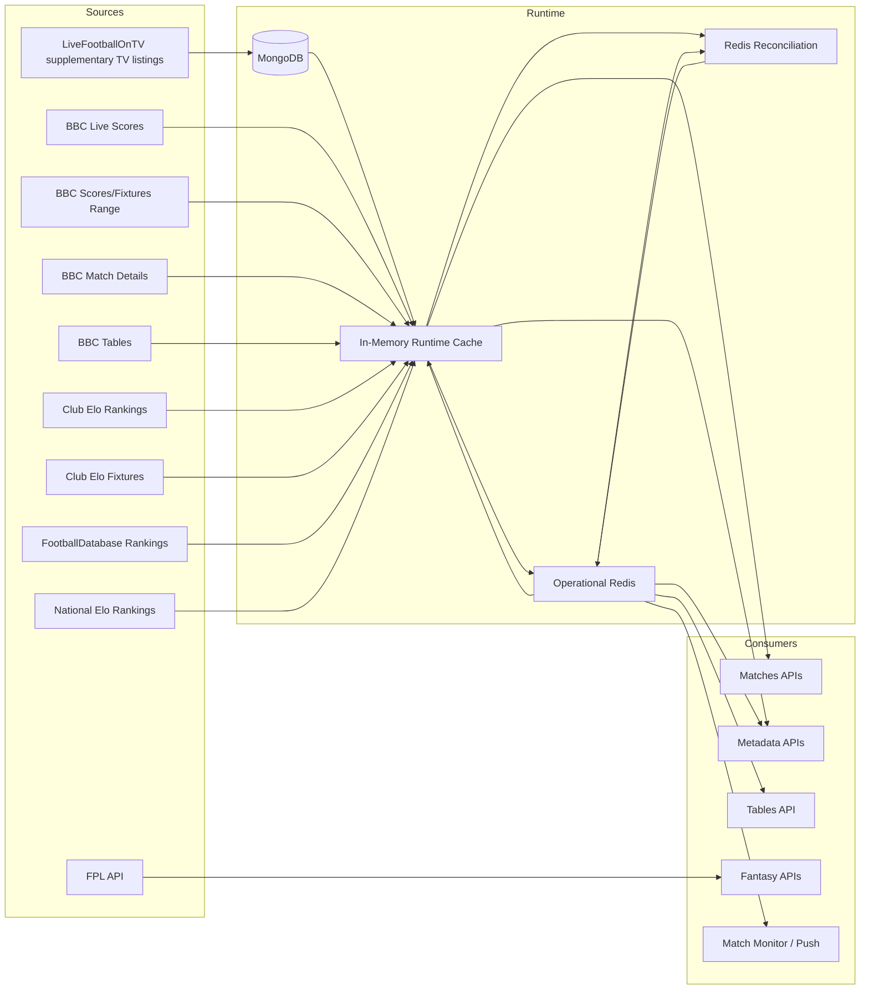
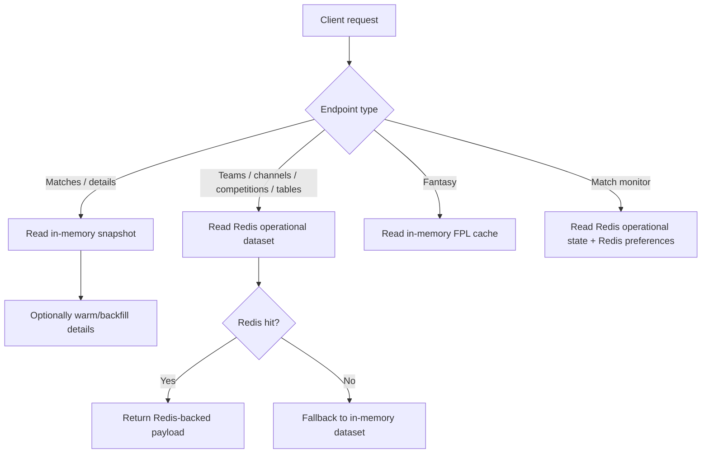
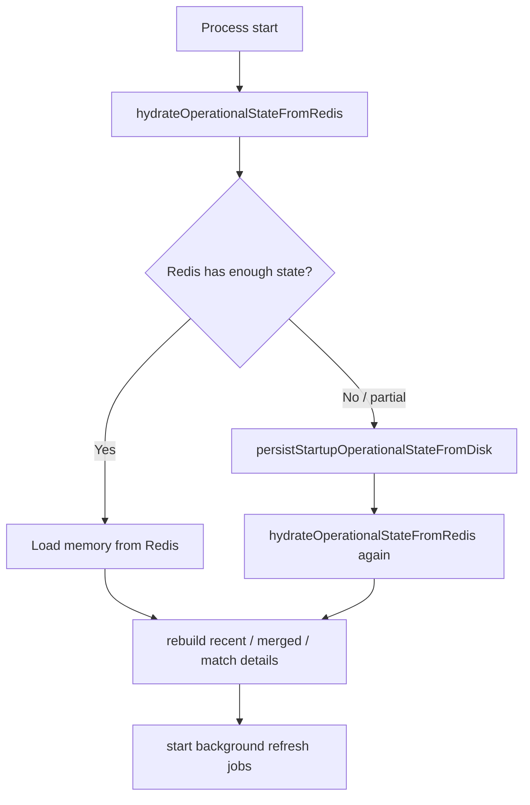
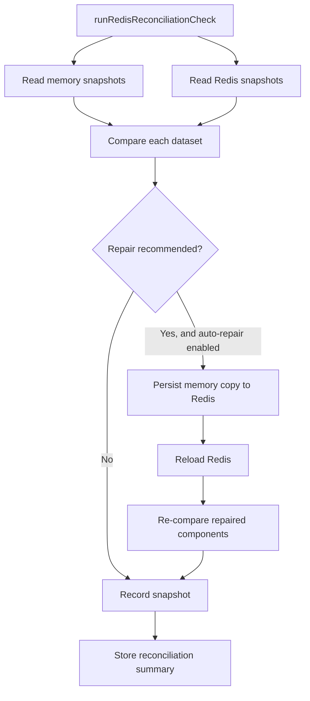

# Architecture Overview

This document describes the current runtime architecture implemented in [`api/server.js`](/Users/mwagstaff/dev/top-scores/api/server.js) and [`api/match_monitor.js`](/Users/mwagstaff/dev/top-scores/api/match_monitor.js).

## High-Level Flow

## 1. External Data Sources

| Source | What it provides | Default pull cadence | Retry behavior | What is updated |
| --- | --- | --- | --- | --- |
| LiveFootballOnTV | Supplementary UK TV channels for fixtures already trusted from BSD | Daily at 05:15 Europe/London, plus the authenticated on-demand endpoint | Retries network, HTTP 429, and 5xx failures with exponential backoff; an incomplete scrape never replaces the active snapshot | `live_football_tv_listings`, then the `bsd_current_matches` serving projection |
| BSD | Fixtures, results, live scores, incidents, lineups, broadcasts, players, predictions, and standings | Live events every 10 seconds; incidents every 30 seconds; other datasets use the BSD poller cadence | HTTP 429-aware exponential backoff and retries | `bsd_*` Mongo collections and the `bsd_current_matches` serving projection |
| BBC Scores/Fixtures Range | Broad past/future fixture coverage | Every 1 hour | No explicit retry in scheduler; multi-page fetch with configured concurrency | `bbc_range_matches`, `merged_matches` |
| BBC Match Details | Detailed scorers/cards/lineups/aggregate state for in-progress matches | Every 10 seconds | Per-target failures are logged and skipped; remaining targets continue | `match_details` |
| BBC Tables | League tables plus EPL team list | Tables every 2 minutes, EPL team list every 24 hours | No explicit retry in scheduler | `league_tables`, `premier_league_teams` |
| Club Elo Rankings | Club ranking metadata | Every 12 hours | No explicit retry in scheduler | `club_elo_teams` |
| Club Elo Fixtures | Fixture-level probability metadata | Every 12 hours | No explicit retry in scheduler | enriches `match_details` |
| FootballDatabase Rankings | Club ranking metadata | Every 12 hours | Explicit retry with exponential backoff and adaptive concurrency | `football_database_teams` |
| National Elo Rankings | International ranking metadata | Every 12 hours | Explicit retry with exponential backoff | `national_elo_teams` |
| Fantasy Premier League API | Bootstrap, fixtures, live event data | Bootstrap every 12 hours plus daily 03:00 UK refresh; fixtures every 6 hours; event live every 15 seconds | No explicit scheduler retry; upstream game-update state is surfaced | In-memory fantasy caches only |

### Retry details

- `FootballDatabase` defaults to 4 attempts with backoff `500ms -> 8000ms`, factor `2`, jitter `250ms`.
- `National Elo` defaults to 5 attempts with backoff `400ms -> 5000ms`, factor `2`, jitter `200ms`.
- `BBC Match Details` is resilient in a different way: one failed match-detail fetch does not abort the whole poll cycle.
- `LiveFootballOnTV` defaults to 3 attempts and honours `Retry-After` for rate limiting. Matching is restricted to allowlisted BSD fixtures; unmatched or ambiguous rows remain in Mongo for audit and are not exposed as fixtures.
- Most other feeds are single-attempt per scheduled run. Freshness recovers on the next interval.

## 2. Which Functionality Uses Which Data Sources

### Functional dependency map

| Functionality | Primary datasets | Backing sources | Failure effect |
| --- | --- | --- | --- |
| `/api/v1/matches` | `bsd_current_matches`, `match_details`, `premier_league_teams` | BSD is the fixture and primary broadcast authority; matched LiveFootballOnTV channels are unioned after BSD channels | BSD match data remains available if supplementary TV ingestion fails; only added future TV coverage becomes stale |
| `/api/v1/matches/:matchId` and `/api/v1/bbc/details` | `match_details` with in-memory fallback payload | BBC live, BBC match details, Club Elo fixtures | Detailed scorers/cards/lineups/aggregate data can be stale or missing |
| `/api/v1/matches/states` | `match_details` | BBC live, BBC match details | Can still hydrate misses from Redis, but freshness depends on detail polling |
| `/api/v1/competitions` and `/api/v1/channels` | `merged_matches` | BSD projection with matched supplementary LiveFootballOnTV channels | Lists become stale if merged cache or Redis copy drifts |
| `/api/v1/teams*` | `merged_matches`, `club_elo_teams`, `football_database_teams`, `national_elo_teams`, `premier_league_teams` | Match feeds + ranking feeds + BBC tables | Team metadata and ranking overlays become stale; endpoint still works from older snapshots if available |
| `/api/v1/tables*` | `league_tables` | BBC tables | Tables become stale or unavailable if both Redis and memory copies are bad |
| Fantasy endpoints under `/api/v1/fantasy/*` | FPL bootstrap, fixtures, event live caches | FPL API | Fantasy gameweek/bootstrap/score/recommendation features return stale data or `503` when caches are missing |
| Match monitor, push notifications, Live Activities | Redis `merged_matches`, `recent_matches`, `match_details`, Redis user preferences, BBC live text | Operational Redis + BBC match details/live text | Notification decisions and live activities degrade or stop if Redis operational state or user preferences are unavailable |

### “What wouldn’t work” by source failure

| Source failure | User-visible impact |
| --- | --- |
| LiveFootballOnTV | BSD fixtures and BSD channels continue unchanged; only supplementary channel coverage stops advancing, with the last complete snapshot retained |
| BBC Live Scores | Live scores/status updates lag; recent cache and initial detail seeding degrade |
| BBC Range | Broad fixture/result coverage degrades; new fixtures may not appear |
| BBC Match Details | Rich match detail pages degrade; monitor/event decisions lose detail |
| BBC Tables | `/api/v1/tables` and EPL-team filters go stale |
| Club Elo Rankings | Club Elo overlays in team/ranking responses go stale |
| Club Elo Fixtures | Match-detail probability enrichment stops updating, but core fixture/result APIs still work |
| FootballDatabase | FootballDatabase-based ranking overlays go stale |
| National Elo | International ranking overlays go stale |
| FPL API | Fantasy endpoints return stale data or `503`; no effect on non-fantasy operational Redis flow |

## 3. Redis vs In-Memory Server Cache

### Source of truth by area

| Area | Primary runtime authority | Redis role |
| --- | --- | --- |
| Matches list and match-detail responses | In-memory cache | Bootstrap/fallback only for some detail paths |
| Competitions, channels, teams, tables | Redis-preferred, memory fallback | Main read path for metadata/table endpoints |
| Match monitor and user preferences | Redis | Required operational dependency |
| Fantasy/FPL | In-memory cache | Not part of operational Redis snapshot |

### In-memory datasets

- `cachedMatches`
- `cachedBbcMatches`
- `cachedBbcRangeMatches`
- `cachedMergedMatches`
- `cachedRecentMatches`
- `cachedLeagueTables`
- `cachedPremierLeagueTeams`
- `cachedClubEloTeams`
- `cachedFootballDatabaseTeams`
- `cachedNationalEloTeams`
- `matchDetailsById`
- FPL caches such as `cachedFantasyBootstrap`, `cachedFantasyFixtures`, `cachedFantasyEventLive`

### Redis-backed operational datasets

- `live_matches`
- `bbc_live_matches`
- `bbc_range_matches`
- `recent_matches`
- `merged_matches`
- `premier_league_teams`
- `league_tables`
- `club_elo_teams`
- `football_database_teams`
- `national_elo_teams`
- `missing_team_logos`
- `cache_state`
- `match_details`

### Read semantics

## 4. Sync and Reconciliation: In-Memory Cache to Redis

### Normal write path

1. A scheduled updater fetches upstream data.
2. The updater writes the fresh payload into the in-memory cache first.
3. The updater persists the corresponding operational dataset to Redis via `persistOperationalDatasetSafe(...)` or `persistOperationalMatchDetailsSafe(...)`.
4. Derived caches are rebuilt as needed, mainly `recent_matches`, `merged_matches`, and `match_details`.

This means memory is the live runtime layer, while Redis is the durable operational snapshot.

### Bootstrap and hydration

### Reconciliation process

Default schedule: every 5 minutes.

Compared stores:

- every operational array dataset listed above
- `match_details`

Comparison signals:

- payload hash
- item count
- `updated_at`
- sample diffs for arrays/objects

Possible statuses include:

- `in_sync`
- `empty`
- `memory_missing`
- `redis_missing`
- `meta_out_of_sync`
- `redis_stale`
- `redis_newer`
- `payload_mismatch`

### Auto-repair behavior

If auto-repair is enabled, reconciliation writes memory back to Redis when Redis is:

- missing
- older than memory
- only metadata-stale

It does not overwrite Redis when Redis is detected as newer.

### Reconciliation flow

## Admin Status Surface

New admin pages:

- `/admin/status`
- `/admin/status/:componentId`

New admin APIs:

- `/api/v1/admin/status/overview`
- `/api/v1/admin/status/components/:componentId`

What the status UI shows:

- interactive architecture flow diagram
- component health at a glance
- per-component detail pages
- last update times
- recent runtime errors
- reconciliation state
- Redis connectivity
- feed/dataset counts

Important scope note:

- The fantasy/FPL caches are shown in admin status, but they are not part of the Redis operational reconciliation loop.

## Match commentary

`/api/v1/matches/:id/commentary` loads separately from scores, key events and
lineups. The API caches BSD's English commentary in `bsd_commentary`, keyed by
event ID, with `updated_at` and `full_refreshed_at`. Concurrent requests in an API
process share one fetch. Cached reads return immediately while stale snapshots
refresh; failures preserve the last successful feed and impose a 30-second
retry cooldown.

Active viewers trigger updates every 15 seconds during play. BSD's `since`
cursor reduces upstream payloads; IDs are deduplicated and the provider's match
order is preserved. A full snapshot every two minutes reconciles corrections
and removals. Commentary accepts only `since` and `order`, so unlike list
endpoints it must not receive `limit` or `offset`.

Upcoming fixtures return an empty, refreshable feed without calling BSD.
Completed matches refresh in full at most once a minute until five hours after
kickoff, then once a day on demand. Empty completed feeds retry after one minute
on subsequent reads. The poller's existing post-match settlement also refreshes
commentary for previously viewed matches only. There is no all-match background
commentary poll.

Responses contain the full cached `commentary` array, `has_play_by_play`,
`updated_at`, `stale`, and `refresh_after_seconds` (null when no further client
poll is needed). A stale completed response asks the client to check again for
the refreshed snapshot. iOS and web fetch only while Commentary is selected and
the app/tab is active; closing the feed cancels client requests. Both show newest
entries first, support a Key moments filter, and initially show ten entries.

## Player Portrait Source

Player portraits use the canonical `cutout_url` response field and the public, long-cache BSD URL `https://sports.bzzoiro.com/img/player/{bsd_player_id}/`.

BSD match projections expose the BSD player identifier as both `id_player` and `bsd_player_id`, allowing clients to pass it directly to the BSD-backed player-details endpoint.

Match-performance statistics come from `/api/v2/events/:id/player-stats/` and are upserted per event into `bsd_player_stats` with `updated_at`. The poller refreshes live matches every 60 seconds and includes stats in its 0/2/15-minute post-match reconciliation. A separate minute cadence processes up to 20 finished matches from the last seven days, retrying each after 24 hours for delayed coverage and corrections. Match-detail reads join the cached stats to starters and substitutes by BSD player ID; they never fetch upstream. The optional lineup `match_stats.rating` is a 1–10 performance score, distinct from the player-profile scouting rating. The pitch defaults to ratings, offers a shirt-number toggle and shows a dash when a rating is unavailable.

`/api/v1/matches/:id/player-stats` loads independently of the match details screen and fills a missing event-stat cache on demand. Concurrent cold requests share a fetch; stale cached data is served while it refreshes. `/api/v1/players/:id/matches` similarly loads independently of the profile and caches the latest 20 played appearances within 90 days in `bsd_player_history`, joining BSD statistics to fixture results. Older fixture metadata is cached separately in `bsd_history_events`, outside the serving fixture collection. Player history retains unrated appearances and avoids assigning a win/loss when the player's team is unknown. Each history response includes an optional canonical `match` only for events currently in `bsd_events`; the app uses this to show a chevron and navigate to match details. Availability is checked even when the history itself is cached.

Grouped standings expose each group's promotion/qualification/relegation bands as `groups[].zones`; flat tables continue to use top-level `zones`. iOS renders and announces the bands within their own group, including promotion and relegation play-offs.

The web and iOS portrait loaders treat decoded 1×1 responses as missing images and fall back to player initials. This is required because the BSD image proxy can return a successful 1×1 missing-image response rather than an HTTP error.

### Ranking sources (October 2026)

Club rankings now come from the published country tables on `https://clubelo.com/Ranking`,
with precise top-100 scores from its embedded JSON chart. Imports require at least 600 teams,
10 KiB of HTML, and a publication date no more than seven days old. Failed validation preserves
the last good dataset. The existing 1,750 Club Elo threshold remains in use. National Elo is unchanged.

The default team ranking source is `clubelo` (which also includes National Elo for national teams).
FootballDatabase polling is disabled by default (`FOOTBALL_DATABASE_ENABLED=false`); while disabled,
a configured `merged`/`footballdatabase` default resolves to `clubelo` to avoid stale blends.
Explicit historical-source queries remain available. Club Elo fixture polling is disabled by default
(`CLUB_ELO_FIXTURES_ENABLED=false`) because its upstream CSV endpoint was deactivated.
These switches are exposed in server diagnostics. Legacy `CLUB_ELO_BASE_URL` overrides
pointing at `api.clubelo.com` automatically migrate to the website ranking route.
